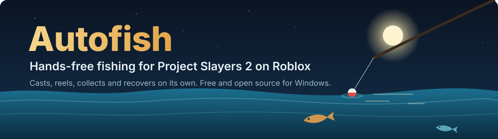
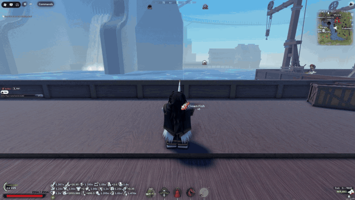
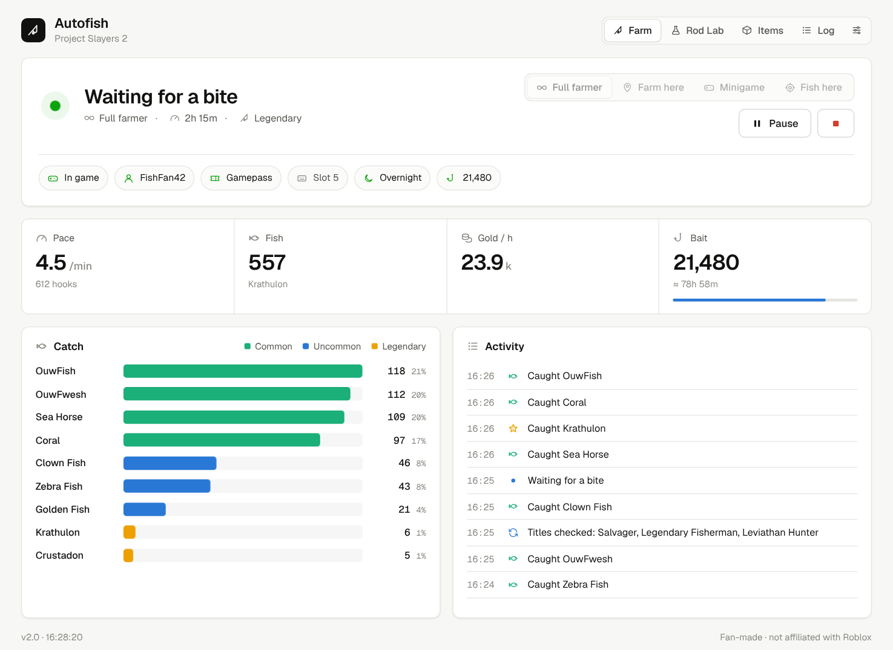
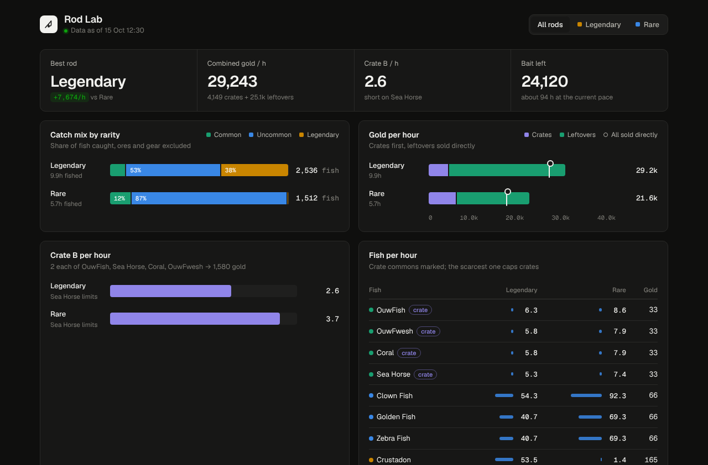

  

  
  
  

**Autofish** plays the fishing minigame in **Project Slayers 2** for you. It casts, wins the minigame, picks up the catch and casts again, hour after hour. If Roblox disconnects, it rejoins and gets back to fishing on its own. A live dashboard shows what you caught, how fast you're fishing and how much your catch is worth.

You don't need to know anything about coding. Download, double-click, done.

  

## Features

- **Fully hands-free.** Casts, plays the reel minigame, holds T to collect drops and recasts.
- **Recovers by itself.** Re-equips your rod and fixes a stuck screen. With the Set Spawn Anywhere gamepass it also rejoins after a disconnect and gets straight back to fishing.
- **Overnight mode.** Waits until you've stepped away, then takes over. Moving your mouse hands control back.
- **A proper app.** One window with live status, Start / Pause / Stop, catches, pace, gold per hour, bait left and a running log. Power users also get a keyboard dashboard in the terminal.
- **Bait buying.** Stand at Baitmonger Nori, pick an amount or a gold budget, and Autofish buys the Fish Heads in bulk. It can go straight back to farming afterwards, and the dashboard tracks how much bait is left.
- **Best fishing titles.** Can equip your three strongest fishing titles for you, with luck or bite speed as the focus for each rod.
- **Rod Lab.** Compares your rods side by side: drop rates, gold per hour and Angler crate value.
- **Discord reports (optional).** One message per session that updates itself with your latest numbers.
- **Any screen.** Works fullscreen or windowed, on laptops and big monitors, at 100 – 150 % Windows scaling.
- **Any light.** Red skies, night and other tinted scenes are balanced automatically, so the minigame is still read correctly.
- **Private.** No Roblox password or cookie is ever used. Your settings and logs stay on your PC.

## The app

  

Autofish.exe opens one window with everything in it: what the farmer is doing right now, Start / Pause / Stop, your catch this run, pace, gold per hour, bait left and a live log. It works in light and dark mode and runs offline on your PC.

## Rod Lab

  

Rod Lab is a tab in the app. It compares your rods side by side: what each one catches, how much gold per hour it earns, and how many Angler crates it fills.

## Install

> **You need:** a Windows 10 or 11 PC, Roblox, and Project Slayers 2 with a fishing rod in your hotbar. Python is installed for you if it's missing.

### 1. Download

Go to the **[latest release](../../releases/latest)** and download the file called **`Autofish-….zip`** under *Assets*.

### 2. Unzip and double-click `Autofish.exe`

Right-click the zip, choose **Extract All…**, and open the extracted **Autofish** folder. Inside there is **Autofish.exe** and an `app` folder. Double-click **Autofish.exe**.

The first time, a window opens and installs everything, which takes a few minutes. Then the Autofish app opens by itself, and you get one **Autofish** icon on your desktop. From then on, just use that icon. You can delete the downloaded folder.

> **"Windows protected your PC"?** That's Windows SmartScreen being careful with a new program from the internet. Click **More info → Run anyway**. All of Autofish's code is in this repository if you want to check it first.

### 3. First-time settings

The first time the app opens, it asks one question: do you own the **Set Spawn Anywhere** gamepass? Click **Yes** or **No**. This decides your main mode:

| Your answer | Main mode | What it means |
| --- | --- | --- |
| **Yes** | **Full farmer** | Your spawn is at your fishing spot, so when Roblox disconnects or something gets stuck, Autofish rejoins and lands right back there. It can run all night on its own. |
| **No** | **Farm here** | Autofish fishes, wins the minigame and claims every catch where you stand, and fixes small problems on the spot. Without the gamepass a rejoin would drop you somewhere else, so after a disconnect it stops and waits for you instead. |

If you answer **Yes**, it then asks for your **Roblox username** (not your display name). Full farmer needs it to check that you're in the game and to rejoin after a disconnect. It is saved only on your PC. You can change both answers any time in **Settings**.

Then open the **Settings** tab and check these:

| Setting | What to enter |
| --- | --- |
| **Username** | Your Roblox **username** (not your display name). Already set if you answered Yes; optional for Farm here, where it helps notice disconnects. |
| **Rod slot** | The hotbar number (1 – 9) your fishing rod is in. |
| **Cast point** | Press **Capture**, then within 4 seconds hover your mouse over the water where you want to cast. |

### 4. Start fishing

1. In Roblox, walk to your fishing spot and face the water. With the gamepass, **set your spawn there** too, so a rejoin brings you back.
2. In the app, pick **Full farmer** (or **Farm here** without the gamepass) and press **Start**.
3. Leave Roblox in front. That's it.

**Controls while it runs** (with Roblox in front):

| Key | Does |
| --- | --- |
| **F8** | Pause / resume |
| **F9** or **F12** | Stop |
| Switching to another app | Pauses automatically; coming back resumes |

## Modes

| Mode | You do | Autofish does |
| --- | --- | --- |
| **Full farmer** *(main mode with the gamepass)* | Set your spawn at the fishing spot once | Everything: rod, casting, minigame, pickup, local fixes, and rejoining back to your spot |
| **Farm here** *(main mode without the gamepass)* | Stand anywhere you can fish | Rod, casting, minigame, pickup and local fixes where you are; stops after a disconnect instead of rejoining |
| **Fish here** | Aim with the mouse, press F8 | Click, reel, collect, repeat |
| **Minigame only** | Cast and collect yourself | Only plays the reel minigame |
| **Auto rejoin** | Play normally | Watches for disconnects and rejoins; no fishing |

**Fish here** and **Minigame** (Minigame only) sit next to Start in the app; **Auto rejoin** is in the terminal dashboard (`autofish rejoin`). Full farmer needs the **Set Spawn Anywhere** gamepass, because rejoining only fixes things when it brings you back to your spot.

## Discord reports (optional)

Get one Discord message per session that edits itself every few minutes with your catches, pace and gold. In your Discord server, open **Server Settings → Integrations → Webhooks → New Webhook → Copy Webhook URL**, then in the app open **Settings → Open terminal dashboard**, paste it in **Settings → Discord webhook** and choose **Test webhook**.

The webhook is stored encrypted for your Windows account and never shown again or uploaded anywhere else.

## Troubleshooting

<b>My screen is small / Roblox isn't fullscreen. Does it still work?</b>

Yes. Autofish reads the game as a 16:9 picture. If your Roblox window has a different shape (for example maximized on a 1366 × 768 laptop, or a 16:10 or ultrawide monitor), Autofish resizes the window to the biggest 16:9 size that fits your screen. If Roblox is fullscreen on a screen that isn't 16:9, it presses **F11** once to leave fullscreen first.

Everything from about 960 × 540 up to 4K works, at 100 %, 125 % or 150 % Windows scaling. If your screen is smaller than that, you'll see a message saying so; use F11 fullscreen on a 16:9 screen or lower Windows display scaling.

<b>Do I need the Set Spawn Anywhere gamepass?</b>

No. Without it Autofish uses **Farm here**: it fishes and claims catches where you stand and fixes small problems itself. The gamepass only adds automatic rejoining after a disconnect, which needs your spawn to be at the fishing spot to be useful.

<b>I don't have an Nvidia graphics card.</b>

That's fine. Autofish reads on-screen text with your processor instead. It's a bit slower (roughly 5 – 10 % fewer hooks per minute) but works the same.

<b>It says "Waiting for Roblox".</b>

Autofish only sends input while Roblox is the window in front, so it never types into another app. Click on Roblox and it continues. Minimizing Roblox, locking the screen or letting the PC sleep pauses it.

<b>It doesn't cast, or casts into the floor.</b>

Set the **Cast point** again with **Settings → Capture** while standing at your spot, and check that your camera faces the water. The rod must be in the hotbar (not only in your backpack) and **Rod slot** must match.

<b>The rod isn't selected.</b>

Put the rod in a visible hotbar slot and set **Rod slot** to that number. Leave **Auto rod** on so Autofish re-equips it when needed.

<b>"Multiple Roblox Player windows"</b>

Close the extra Roblox windows. Autofish works with one Roblox client at a time.

<b>How do I update?</b>

Download the new zip from [Releases](../../releases/latest), unzip it and double-click its **Autofish.exe**. It updates your installed copy and keeps your settings, stats and webhook.

<b>How do I uninstall?</b>

Stop Autofish, run `scripts\Install-CLI.cmd -Uninstall` from `%LOCALAPPDATA%\Autofish\app` to remove the `autofish` command, delete the **Autofish** desktop icon, then delete the `%LOCALAPPDATA%\Autofish` folder (this also deletes your stats). Nothing else is installed: no service, no scheduled task, no admin rights.

Still stuck? [Open an issue](../../issues/new/choose) with your screen resolution, Windows scaling and the last lines of `autofish logs --activity`.

## Disclaimer

Autofish is a fan-made tool. It is **not affiliated with, endorsed by or supported by Roblox Corporation** or the makers of Project Slayers 2.

Roblox's [Terms of Use](https://en.help.roblox.com/hc/en-us/articles/115004647846) and many games' rules don't allow automation, macros or bots. Using Autofish **may get your account warned, suspended or banned**. You use it entirely at your own risk; the authors accept no responsibility for what happens to your account.

Autofish only looks at your screen and presses keys and mouse buttons like a person would. It doesn't read or change the game's memory, doesn't use your password or cookie, and doesn't give you anything that normal play can't.

## For tinkerers

- **[Full manual](docs/MANUAL.md):** every mode, setting, hotkey, file and command (`autofish status`, `autofish logs`, `autofish predictions` …).
- **Run from source:** install Python 3.12 (64-bit), clone the repo and double-click `scripts\Setup.cmd`. Tests: `.\.venv\Scripts\python.exe -m unittest discover -s tests`.
- **Repo layout:** `src/` the app (Python), `scripts/` Windows setup and launch scripts, `assets/` game templates and icons, `launcher/` the Autofish.exe source, `docs/` manual and images, `tests/` the test suite.
- **[Contributing](CONTRIBUTING.md):** bug reports, screenshots from unusual setups and pull requests are welcome.

Released under the [MIT license](LICENSE).
